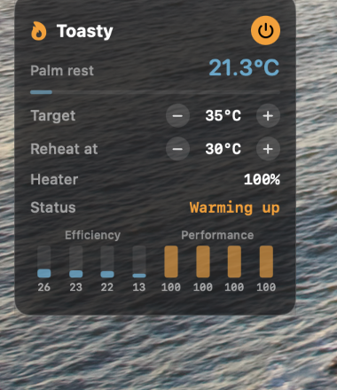

# Toasty

A small macOS app that warms up a cold MacBook so the palm rest is nice to rest your hands on.

When you open the lid, Toasty runs the performance cores until the palm rest reaches your target temperature (35 °C by default), then rests. When it cools to the reheat point (30 °C), it warms it up again. It never slows down the apps you are using.

<p align="center">
  
</p>

## Download

**[Download Toasty.app.zip](https://github.com/LondonVista/Toasty/releases/latest/download/Toasty.app.zip)** (latest release, Apple Silicon)

Unzip, move `Toasty.app` to Applications, then right-click it and choose **Open** the first time (the app is not notarized).

## Features

- **Palm rest temperature** from the battery sensor, which sits right under your palms.
- **Swing mode**: heat to the target, rest, reheat when it drops to the reheat point.
- **Lid open trigger**: starts on wake, but only heats a Mac that is actually cold. The power button heats straight away.
- **Only while you are there**: pauses after 2 minutes without mouse or keyboard input.
- **Shares the Mac**: uses at most the 4 performance cores at low priority, drops to half power when other apps get busy or macOS reports thermal pressure, and stops at critical heat or 105 °C on the chip.
- **Live core load** for every efficiency and performance core.
- **Battery aware**: optional on battery, stops below 20 %.
- Glass card that docks under the [iPhone Battery Widget](https://github.com/LondonVista/iPhoneBatteryWidget) when it is running and follows it as it resizes. Drag the card to move it; near the widget it snaps to its edges. A Dock menu holds the settings.

## Requirements

- A Mac with Apple Silicon (M1 or later) and macOS 13 or later.
- Works best on a MacBook Air: no fans, so the heat stays in the case. On a MacBook Pro it works too, but the fans carry some heat away and may spin up.

## Build

Needs the Xcode Command Line Tools.

```bash
git clone https://github.com/LondonVista/Toasty.git
cd Toasty
./build.sh            # builds, installs to /Applications and opens Toasty
./build.sh --heat-now # same, and starts heating straight away
```

## Settings

Click the card for the power button and the target and reheat steppers. Right-click the Dock icon for the rest: keep warm for a set time, start when the lid opens, pause when idle, run on battery and open at login.

## How it works

- Temperatures come from the Apple Silicon HID temperature sensors, which need no admin rights.
- Heat comes from 4 threads of vector multiply-adds, which keep each core's floating point units busy and draw more power than a plain loop.
- State changes are written to `~/Library/Logs/Toasty.log`, so you can see why it heated or rested.

Keeping the battery warm wears it a little faster over the years. Use a moderate target and run it plugged in when you can.
